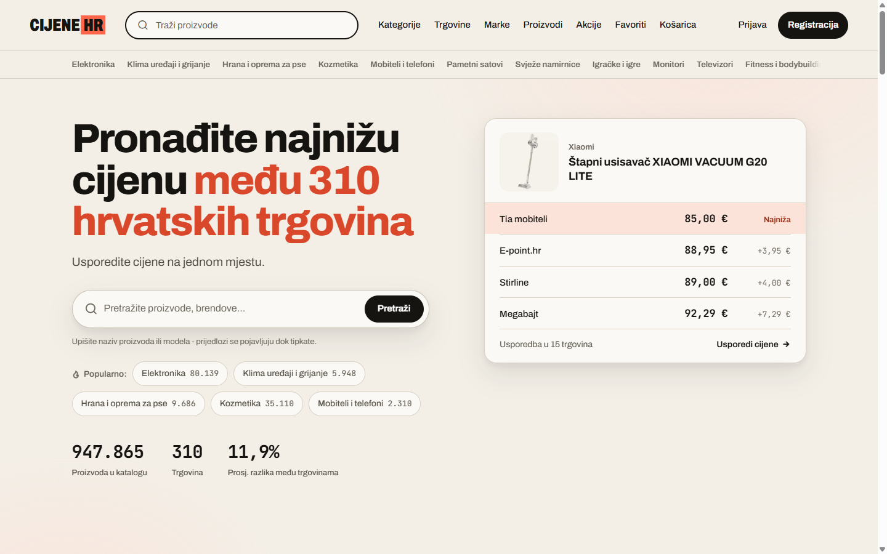

# CijeneHR

**Price comparison across 300+ Croatian stores, tracking over a million products with price history.**

[cijenehr.com](https://cijenehr.com) · [Case study](https://agicad.com/portfolio/cijenehr/)

> The source code is private. This repository documents the product and how it is built. The site is in Croatian.

## The problem

Scraping hundreds of retailers with different page structures is hard. The harder question is which failures are worth fixing, because a broken selector and a blocked request look the same from outside. Suspicious rows raise a second question: quarantining them when they are written loses real offers, but showing them unchecked costs trust the first time a price is wrong.

## How it's built

- **Failure classifier.** A pure classifier sorts every fetch into seven categories: ok, price present but unparsed, JSON-LD with no price, no price, anti-bot, transport failure and empty. It sits behind a swappable page-source seam, so it runs on the real fetch path and stays unit-testable.
- **Recoverability report.** An artisan command ranks stores by how much volume is recoverable. It showed that transport was the ceiling, not selectors, so selector work was deliberately not scheduled.
- **Trust, then verify.** Suspicious rows get review-only flags and are never switched off automatically. Validation at display time is the single enforcement point, and the decision is recorded in an ADR.
- **Browser tests driven by the route table.** A command builds a Playwright manifest from the route table and resolves route-model-bound parameters to seeded rows. It caught production bugs that unit tests missed.
- **Safe legacy refactoring.** Golden-master tests pinned the behaviour of the largest legacy classes before any refactor. Dead code was removed only with evidence: static analysis, access logs, or a deprecation shim plus a watch window.
- **Outage post-mortem.** One whole-pipeline outage came down to a missing working directory in the process manager config. That missing directory made every source fail its smoke check and tripped the circuit breaker. The directory is now pinned in the process manager and in every Node launcher.

## Stack

PHP 8.2+, Laravel 12, Vue 3, TypeScript, Tailwind CSS, MySQL, Redis, Playwright, GitHub Actions.

## Author

Built and run by [Toni Ilić](https://github.com/toniilic). I take on side projects through [AgiCAD](https://agicad.com).
